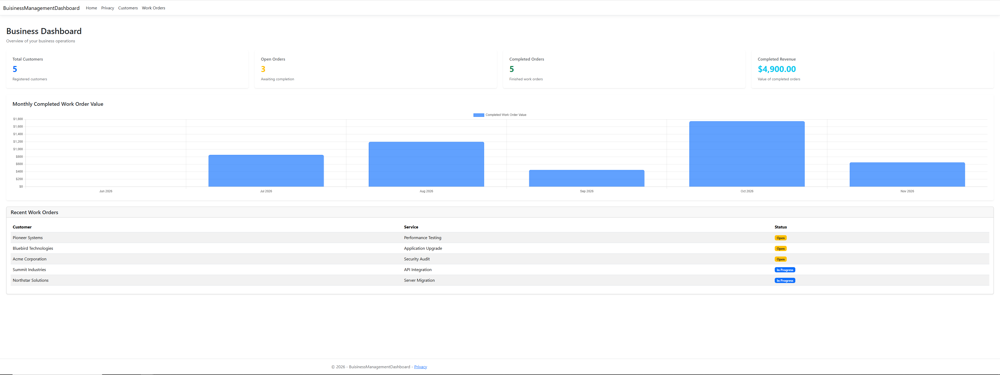
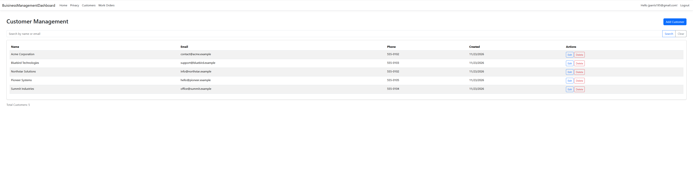
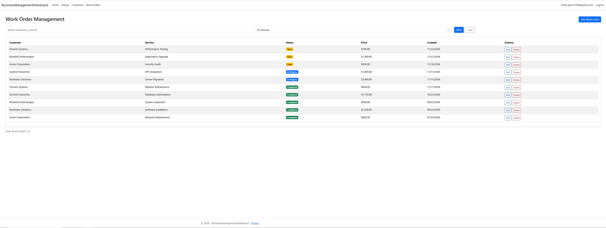

Application Architecture

The application follows the Model-View-Controller (MVC) architectural pattern, with a dedicated service layer to separate business logic from HTTP request handling.

Models: Define customer, work order, and business data entities.

Views: Provide responsive user interfaces using Razor Views and Bootstrap.

Controllers: Handle HTTP requests, model validation, authorization, and communication with application services.

Service Layer: Encapsulates business rules, database operations, and application functionality through dedicated service classes.

Service Interfaces: Define contracts for customer management, work order management, and dashboard reporting.

Dependency Injection: Provides service implementations to controllers through ASP.NET Core's built-in dependency injection system.

ViewModels: Separate form input and validation from database entities.

Entity Framework Core: Manages database access, relationships, and migrations.

ASP.NET Core Identity: Provides authentication and role-based authorization.

Service Layer

The application includes three primary services:

CustomerService: Handles customer retrieval, searching, pagination, creation, updates, and deletion protection.

WorkOrderService: Manages work orders, status validation, customer relationships, and automatic completion dates.

DashboardService: Calculates dashboard statistics, completed revenue, recent work orders, and monthly revenue reporting.

Each service implements a corresponding interface, improving maintainability, separation of concerns, and automated testability.

## Security Design

The application separates public dashboard access from administrator-only management functionality.

**Public visitors**
- Can view dashboard statistics and reporting information.
- Cannot access customer or work order management.
- Cannot register new accounts through the standard registration endpoint.

**Administrators**
- Can securely sign in and out.
- Can create, update, and delete customer records.
- Can manage work orders and their statuses.
- Can access protected management functionality.

Development-only database seeding and administrator role assignment are restricted to the Development environment.

## Running the Application Locally

### Prerequisites
- .NET 10 SDK
- Visual Studio 2026 with ASP.NET and web development support
- SQL Server LocalDB

### Setup Instructions

1. Clone the GitHub repository.
2. Open the solution in Visual Studio 2026.
3. Configure the local SQL Server connection string in `appsettings.Development.json`.
4. Restore NuGet packages.
5. Apply Entity Framework Core migrations using `Update-Database` in Package Manager Console.
6. Build and run the application.

The Development environment includes fictional demonstration data for testing and portfolio purposes.

Administrator access requires a separately provisioned account.

**Security note:** Local development settings and credentials should never be committed to the repository.

## Application Screenshots

### Dashboard Overview

### Customer Management

### Work Order Management

## Development Highlights

This project demonstrates practical experience with:

- Full-stack C# and ASP.NET Core development
- MVC application architecture
- Relational database design
- Entity Framework Core migrations
- CRUD operations and data validation
- User authentication and role-based authorization
- Secure access to management functionality
- Search, filtering, and pagination
- Interactive data visualization
- Responsive web design
- Git version control

## Future Enhancements

Planned improvements include:

Dedicated production demonstration database.

Additional dashboard reporting and analytics.

Exportable business reports.

Expanded automated unit testing and integration testing.

Cloud deployment when hosting becomes available.

Additional application features based on business requirements.

## Project Status

**Functional local portfolio demonstration**

The application is developed and tested locally using Visual Studio 2026 and SQL Server LocalDB.

Source code is maintained in GitHub. Public hosting is planned for a future release.